  

  

  
  
  
   
  
  
  

## ⚔️ Current arc · Wells Fargo

<table>
  <tr>
    <td width="62%">
      <b>Technology Program Intern</b> · <i>June to August 2026</i> 
      <b>Commercial and Corporate Investment Banking Technology</b>  
      Architected, built and orchestrated an <b>AI agent</b> for the Commercial and Corporate Investment Banking line of business.  
      
      
      
    </td>
    <td width="38%" align="center">
      
       <a href="https://shadowbeast0.github.io/#wells">Fight MANUAL WORK on my site →</a>
    </td>
  </tr>
</table>

## 🌌 System overview

- 🎓 **Academics:** B.E. in Computer Science & Engineering at **Jadavpur University** (2023–2027), **9.5 CGPA** · **Class Representative**
- 🧠 **Leadership:** **ML Core Team Member** @ Code Club JU (CCJU) · **Core Organiser** of **OpenAImer**, the flagship AI/ML event of SRIJAN, Jadavpur University's tech fest
- ⚡ **Focus:** GenAI, agentic AI, advanced RAG, neural architectures, LLMs, agentic workflows, and fast, scalable applications

## 🛠️ Arsenal

   
   
  

<b>Also in the loadout:</b> LangChain · LangGraph · LlamaIndex · PyTorch Geometric / DGL · Three.js · WebSockets · Chroma DB · LlamaParse

## 🔬 Research & experience

| | |
|:--|:--|
| 🧬 **SAGED-Net** ·  | Lightweight nuclei segmentation with learnable Adaptive Gating and a Tri-Domain Fidelity loss; outperforms state-of-the-art benchmarks on TNBC, CPM and PanNuke. |
| 🩸 **LGLD-Net** ·  | Dual-stream global-local network for blood-cell images: 96.69% on ALL and 96.5% on Raabin-WBC, new state of the art. |
| 🕸️ **Graph transformers** ·  | Implemented GCN, Graph Transformer and NAGPhormer baselines; customised SGFormer and DualFormer with significant accuracy gains. Advised by Prof. Swagatam Das. |

Undergraduate Researcher at <b>CMATER Lab, Jadavpur University</b>, advised by Prof. Ram Sarkar.

## 💻 Featured builds

<table>
  <tr>
    <td width="50%" valign="top">
      <h3>🎓 <a href="https://github.com/shadowbeast0/LexicognitionAI">Lexicognition AI</a></h3>
       
      
      
Turns a research-paper PDF into an adaptive oral exam with evidence-grounded grading: LLM-generated questions, critique-based scoring and real-time streaming ingestion (SSE).

    </td>
    <td width="50%" valign="top">
      <h3>✈️ <a href="https://github.com/shadowbeast0/BookMyFlight">BookMyFlight</a></h3>
      
      
A cyber-aesthetic flight booking platform with a live deals engine, an interactive 3D globe, a built-in wallet and an OTP + JWT secured Spring Boot backend.

    </td>
  </tr>
  <tr>
    <td width="50%" valign="top">
      <h3>🍔 <a href="https://github.com/shadowbeast0/BunChat---AI-powered-ChatApp">BunChat</a></h3>
      
      
Real-time WebSocket chat with DMs, groups and a social feed, guarded by a hybrid AI moderation engine with an AI de-escalation system.

    </td>
    <td width="50%" valign="top">
      <h3>🏎️ <a href="https://github.com/shadowbeast0/Braking-Bad">Braking Bad</a></h3>
      
      
A physics-based 2D hill-climb racer built with Qt: custom raster graphics, collision detection and dynamic vehicle mechanics.

    </td>
  </tr>
  <tr>
    <td width="50%" valign="top">
      <h3>🧠 <a href="https://github.com/shadowbeast0/EmoCareBot--Mental-Health-Support-Chatbot">Emo Care Bot</a></h3>
      
      
A mental-health support chatbot: NLTK tokenisation and lemmatisation, a Keras intent classifier and Flask for live support.

    </td>
    <td width="50%" valign="top">
      <h3>🎙️ <a href="https://github.com/shadowbeast0/Voice-Assistant">AI Voice Assistant</a></h3>
      
      
A real-time voice interface with an LLM-backed dialogue layer powered by Gemini.

    </td>
  </tr>
  <tr>
    <td width="50%" valign="top">
      <h3>🖋️ <a href="https://github.com/shadowbeast0/Signature_Verification_App">Signature Verification</a></h3>
      
      
Canny-edge features plus a Siamese network that tells genuine signatures from forgeries.

    </td>
    <td width="50%" valign="top">
      <h3>🤖 <a href="https://github.com/shadowbeast0/Bun-Bot">Bun Bot</a></h3>
      
      
An all-in-one Discord companion for moderation, server setup and engagement, loaded with minigames.

    </td>
  </tr>
</table>

## 🏆 Milestones

| | |
|:--:|:--|
| 🥇 | **Lexicognition AI champion (team lead):** the AI/ML event of **Kshitij 2026**, IIT Kharagpur's tech fest, judged and tested by Microsoft |
| 🥇 | **OpenAImer 2025 champion (team lead):** the flagship AI/ML hackathon of **SRIJAN 2025**, Jadavpur University's tech fest |
| 🏅 | **Special Mention:** National Cyber Security Awareness using AI Ideathon, with *EdgeGuard-FLX* |
| 📜 | **Published:** IEEE Xplore, IJCNN (WCCI) 2026 with SAGED-Net · Springer Nature, 19th ICITA 2025, Oslo with LGLD-Net |

## 📊 Uplink data

  
  

  

  

  
<b>Full metrics</b>

   
  

  

<i>If you're building something in AI/ML, agentic AI or modern web systems, let's talk.</i>

